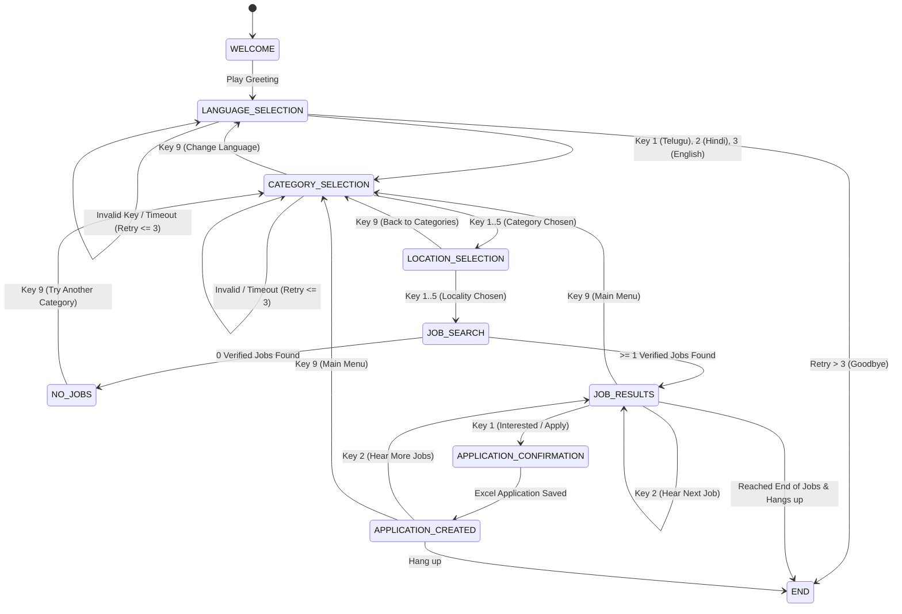

# LocalJobs IVR State Machine & Call Flow

## 1. State Machine Overview

The telephone IVR is implemented as an explicit, deterministic finite state machine (FSM) with timeout and retry controls.

---

## 2. Keypad Matrix & Navigation

| State | DTMF Key | Action / Transition | Next State |
| :--- | :--- | :--- | :--- |
| **`LANGUAGE_SELECTION`** | `1` | Select Telugu (`te`) | `CATEGORY_SELECTION` |
| | `2` | Select Hindi (`hi`) | `CATEGORY_SELECTION` |
| | `3` | Select English (`en`) | `CATEGORY_SELECTION` |
| | Any other | Invalid Input Prompt (max 3 retries) | `LANGUAGE_SELECTION` |
| **`CATEGORY_SELECTION`** | `1` | Select Driver | `LOCATION_SELECTION` |
| | `2` | Select Construction | `LOCATION_SELECTION` |
| | `3` | Select Electrician | `LOCATION_SELECTION` |
| | `4` | Select Cleaner | `LOCATION_SELECTION` |
| | `5` | Select Shop / Helper | `LOCATION_SELECTION` |
| | `9` | Main Menu / Change Language | `LANGUAGE_SELECTION` |
| **`LOCATION_SELECTION`** | `1` | Uppal | `JOB_RESULTS` / `NO_JOBS` |
| | `2` | Kukatpally | `JOB_RESULTS` / `NO_JOBS` |
| | `3` | Dilsukhnagar | `JOB_RESULTS` / `NO_JOBS` |
| | `4` | Secunderabad | `JOB_RESULTS` / `NO_JOBS` |
| | `5` | All Nearby Areas | `JOB_RESULTS` / `NO_JOBS` |
| | `9` | Return to Categories | `CATEGORY_SELECTION` |
| **`JOB_RESULTS`** | `1` | Express Interest (Apply with phone) | `APPLICATION_CREATED` |
| | `2` | Hear Next Job | `JOB_RESULTS` |
| | `9` | Main Menu | `CATEGORY_SELECTION` |
| **`APPLICATION_CREATED`** | `2` | Hear Next Job | `JOB_RESULTS` |
| | `9` | Main Menu | `CATEGORY_SELECTION` |
| | Hangup | Call Completes Gracefully | `END` |

---

## 3. Error & Timeout Handling Rules

1. **Invalid Keypress**:
   - Replays current prompt prefixed with localized error: *"Invalid choice. Please try again."*
   - Increments session `retry_count`.
   - After 3 consecutive invalid attempts: resets state to `CATEGORY_SELECTION` or `WELCOME`.
2. **Silence / Timeout**:
   - Replays current prompt prefixed with: *"We did not receive any input. Please make a selection."*
   - Increments session `timeout_count`.
   - After 3 consecutive timeouts: ends call gracefully with *"Thank you for calling LocalJobs. Goodbye."*
3. **No Infinite Loops**:
   - Every state strictly bounds retry attempts. Sessions are cleared upon hangup or timeout exhaustion.
